# Job Board

Job board — ASP.NET Core 9 + EF Core (MySQL) + Angular 22 (Angular Material).
Portfolio project with candidate, employer and admin roles, running locally as a Docker stack (file storage, e-mails, statistics).

## Architecture highlights

- **Backend:** controllers + repositories, one place for resource authorization (`ICurrentUserAccess`, foreign resources return 404), transactional e-mail outbox, rate limiting per client IP.
- **Files:** `IFileStorage` with local disk or S3 (SeaweedFS), uploads validated by content (PDF, DOCX, PNG, JPEG), size limits checked before the body is read.
- **Frontend:** standalone components, signals and OnPush, lazy routes, URL-driven filters, WCAG 2.2 AA checked with axe.
- **Docker Compose:** nginx (frontend + `/api` proxy), API, MySQL, SeaweedFS and Mailpit, ports bound to `127.0.0.1`.

## Tech stack

| Area | Technologies |
| ---- | ------------ |
| Backend | .NET 9, ASP.NET Core Web API, ASP.NET Core Identity, JWT |
| Data and storage | EF Core 9 + Pomelo (MySQL 8.4), SeaweedFS (S3 API) |
| E-mail | MailKit, outbox table + background worker, Mailpit locally |
| Frontend | Angular 22, Angular Material, RxJS, TypeScript 6 |
| Testing | xUnit + WebApplicationFactory, Vitest, Playwright + axe-core |
| Tooling | Docker Compose, nginx, PowerShell (`docker-up.ps1`) |

## Prerequisites

- Docker Desktop
- Git, PowerShell (Windows) for `docker-up.ps1`

## Quick start

```powershell
git clone https://github.com/PiotrSmola/Job-Board-.NET-Angular.git
cd Job-Board-.NET-Angular
.\docker-up.ps1    # builds the images, generates secrets in .env, starts the stack
```

- Frontend: http://localhost:4200
- API (Swagger): http://localhost:5285/swagger
- Mailpit (all e-mails sent by the app): http://localhost:8025
- MySQL: `localhost:3306`

If a port is taken, the script picks the next free one and prints the final addresses. Migrations and demo data are applied on the first start.

## Features (demo checklist)

| Role | Capabilities |
| ---- | ------------ |
| Visitor | Offer list with search and faceted filters (category, level, contract, work mode, skills, salary), offer details, company profiles with photo galleries, sign up as a candidate or an employer |
| Candidate | Apply with files and profile documents, application status history, withdraw and re-apply, saved offers, profile and documents, password change and reset, e-mail notifications |
| Employer | Company profile (re-verified after a name or website change), photo gallery and offer background, offers (drafts, publishing, expiry), applications with status changes and comments, statistics with CSV export |
| Admin | Company verification, offers, applications, categories, photo moderation, platform statistics, demo data reset |

## Configuration

### Secrets

`docker-up.ps1` creates `.env` (git-ignored) and keeps existing values. See `.env.example`.

| Key | Purpose |
| --- | ------- |
| `JWT_SECRET` | Signing key for access tokens (generated) |
| `S3_ACCESS_KEY`, `S3_SECRET_KEY` | SeaweedFS credentials (generated) |
| `ADMIN_PASSWORD` | Password of the seeded admin accounts on a new database (generated, printed by the script) |
| `DB_PASSWORD` | MySQL root password |
| `ALLOW_SEED_REFRESH`, `SEED_DEMO_ACCOUNTS`, `SWAGGER_ENABLED` | Demo data reset, demo accounts and Swagger UI (on by default locally) |

### Demo accounts

| Role | Email | Password |
| ---- | ----- | -------- |
| Admin | `admin@jobboard.com` | value of `ADMIN_PASSWORD` (`Admin123!` in Development) |
| Employer (verified company) | `rekruter@techcorp.pl` | `Employer123!` |
| Employer (company awaiting verification) | `rekruter@nowafirma.pl` | `Employer123!` |
| Candidate | `jan.kowalski@example.com` | `User123!` |
| Candidate | `anna.nowak@example.com` | `User123!` |

## Security

- JWT with a 2-hour lifetime, security stamp check on every request (password change or account deletion invalidates tokens).
- Rate limits on sign-in, registration, password reset e-mails, uploads and public lists; account lockout after 5 failed sign-ins.
- Ownership checks on every resource; another company's offers, applications and files return 404.
- Security headers and CSP in nginx, gzip, 1 MB request limit except uploads (26 MB).
- Notifications only to confirmed e-mail addresses; reset and confirmation links are single-purpose tokens.
- Backend container runs as a non-root user; secrets live only in `.env`.

## Development commands

```bash
# backend tests (MySQL required; fast suite without migration tests)
cd Backend.Tests
dotnet test --filter "Category!=Migrations"
dotnet test

# frontend unit tests and build
cd frontend
npx ng test --watch=false
npx ng build

# end-to-end tests against a running stack (Playwright)
npm run e2e
```

## Screenshots

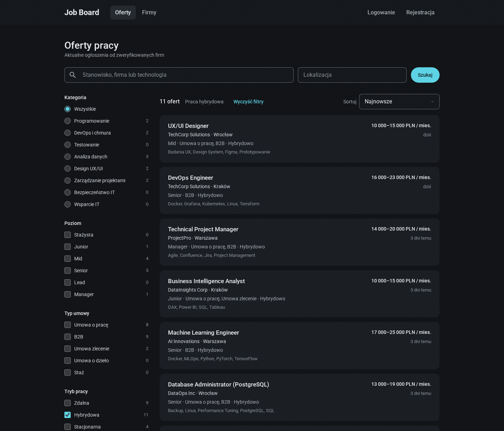

| Offer details | Company profile |
| ------------- | --------------- |
| 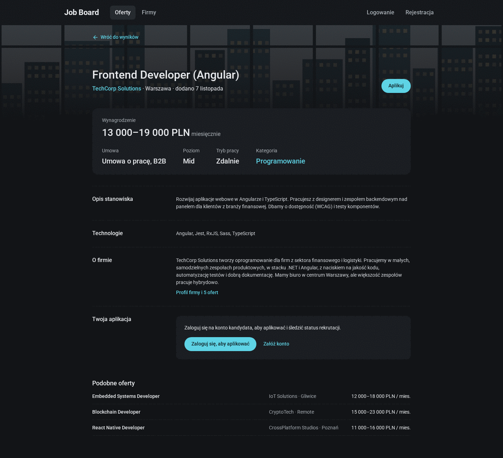 | 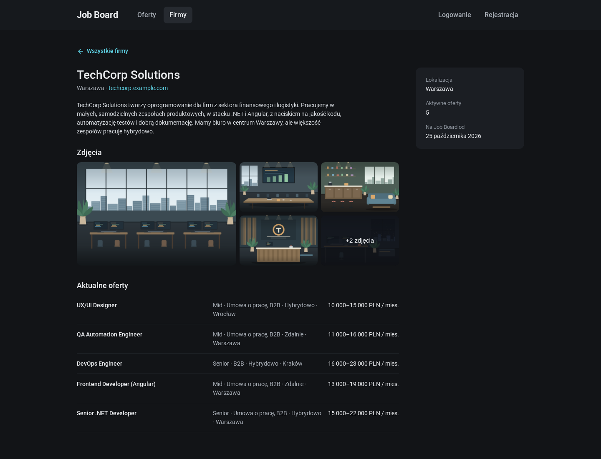 |

| Applying | My applications |
| -------- | --------------- |
| 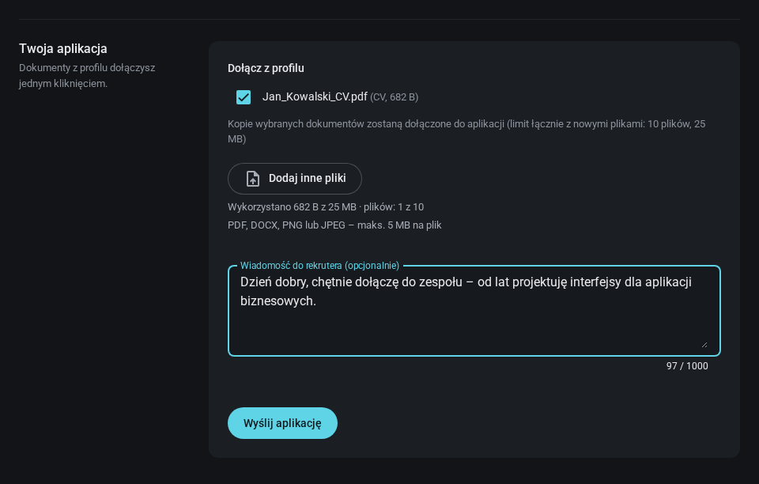 | 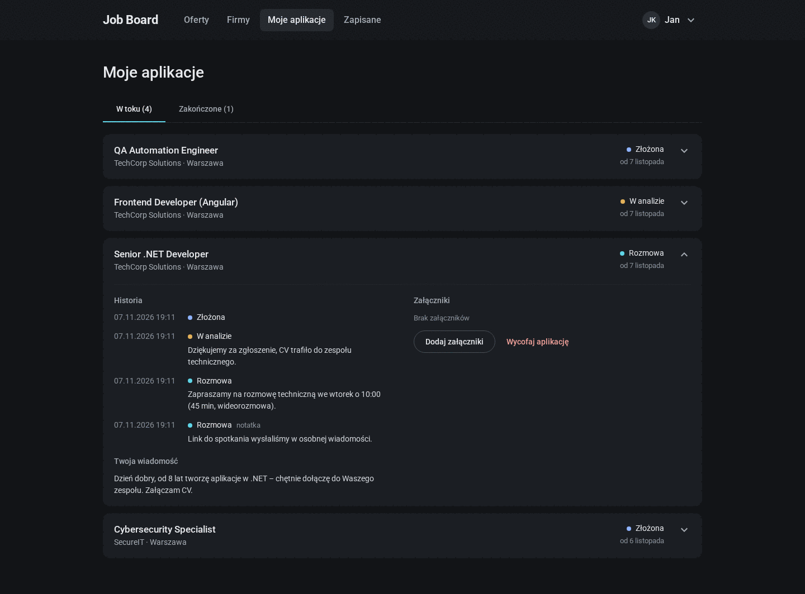 |

| My account | Sign up |
| ---------- | ------- |
| 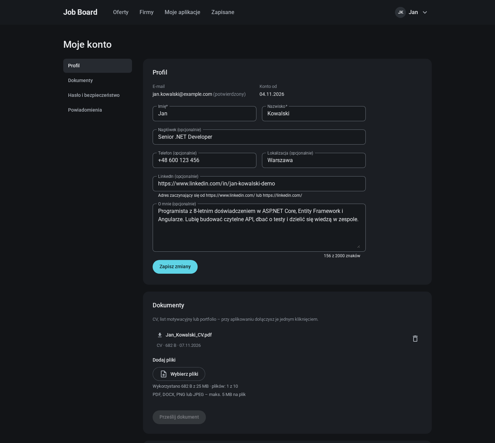 | 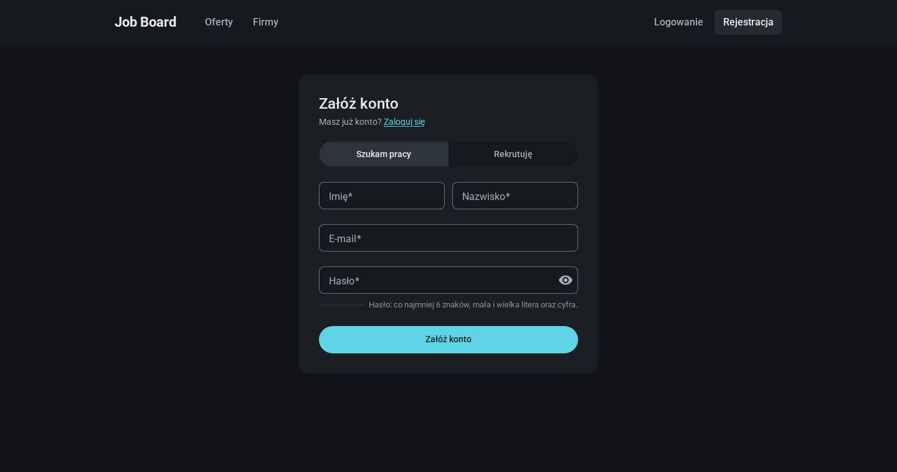 |

| Employer – offers | Employer – company profile |
| ----------------- | -------------------------- |
| 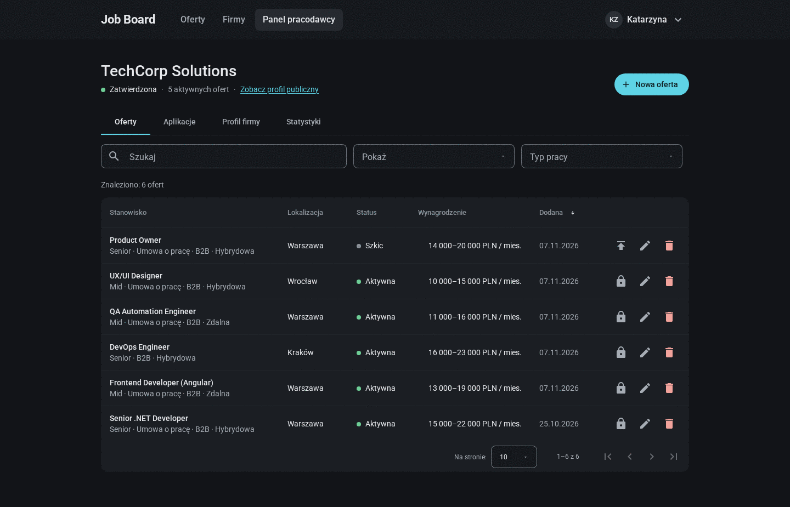 | 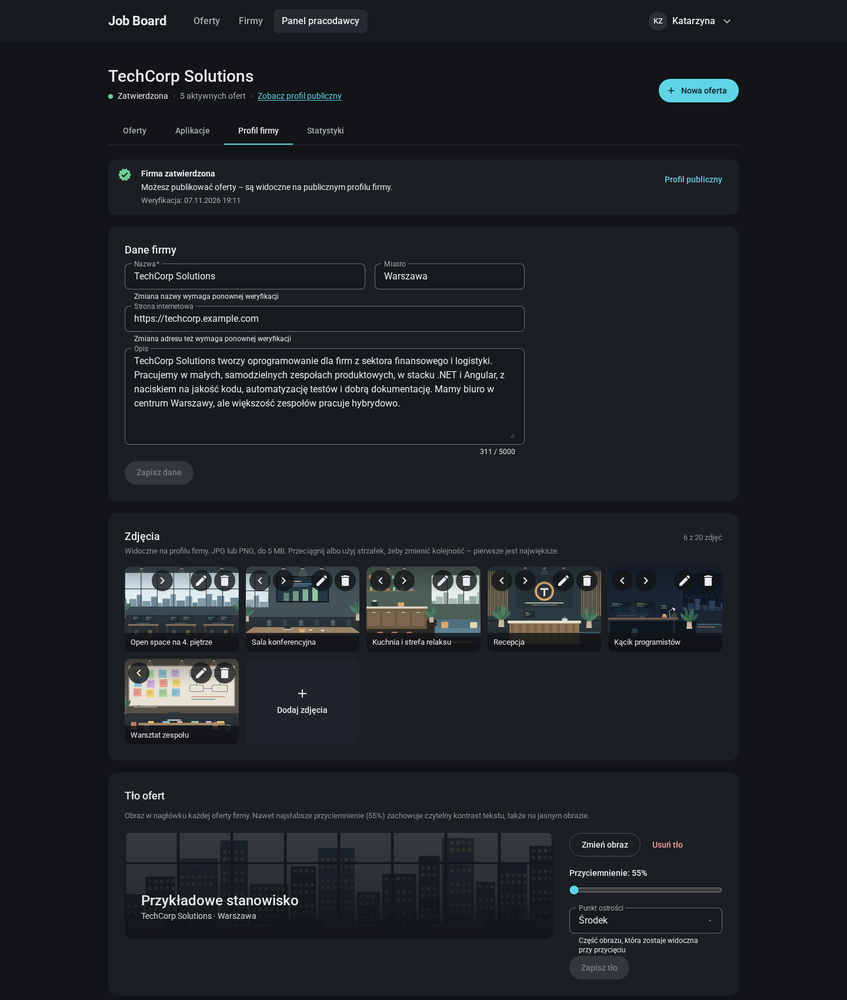 |

| Admin – statistics | Admin – companies |
| ------------------ | ----------------- |
| 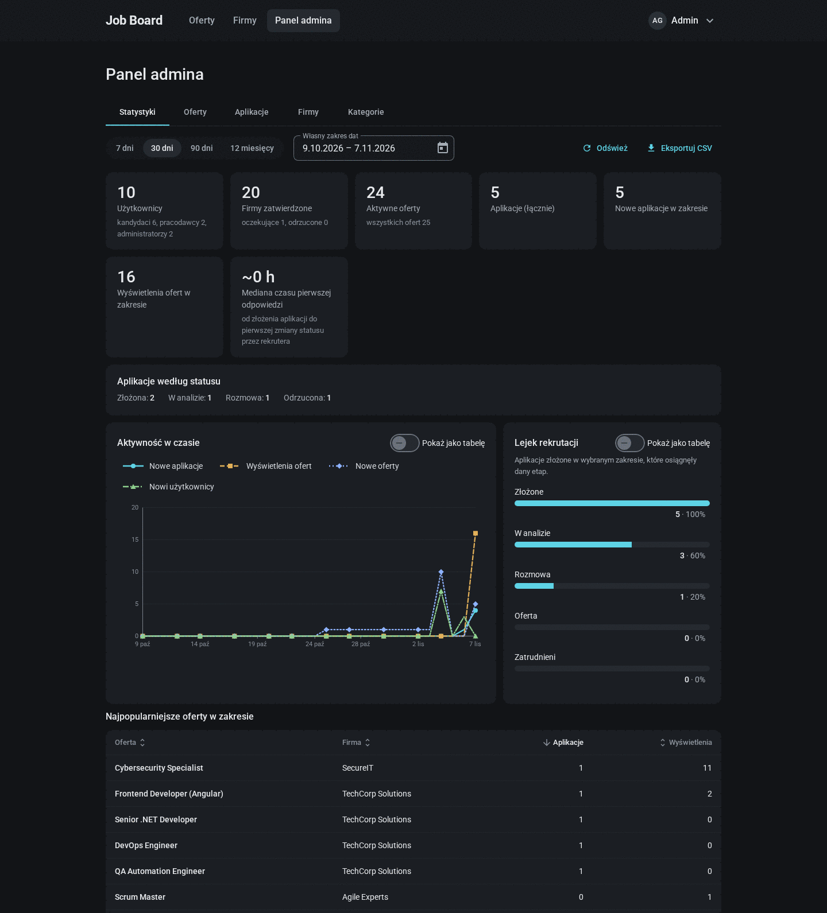 | 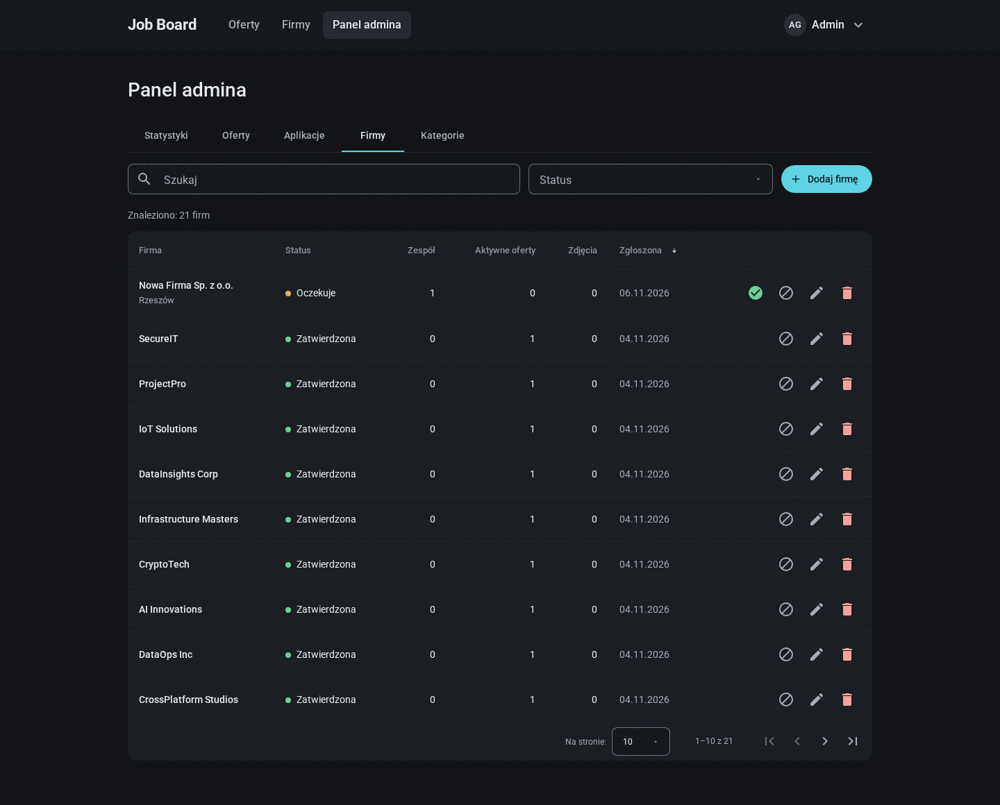 |

| Mobile |
| ------ |
| 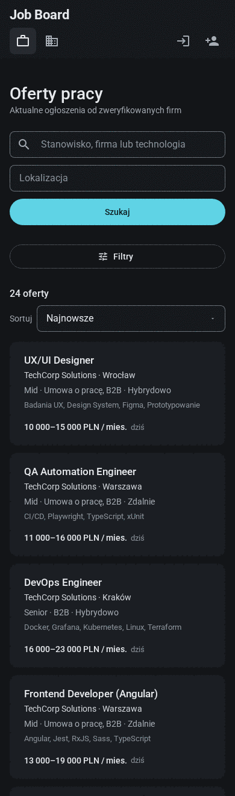 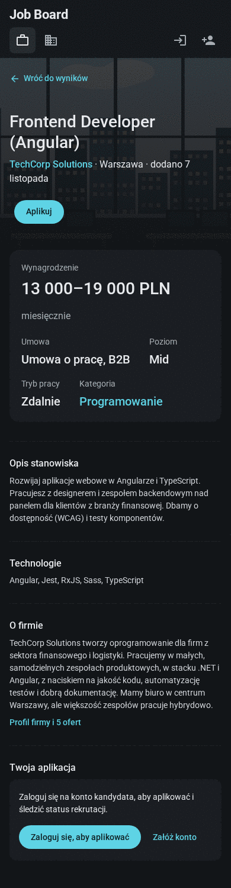 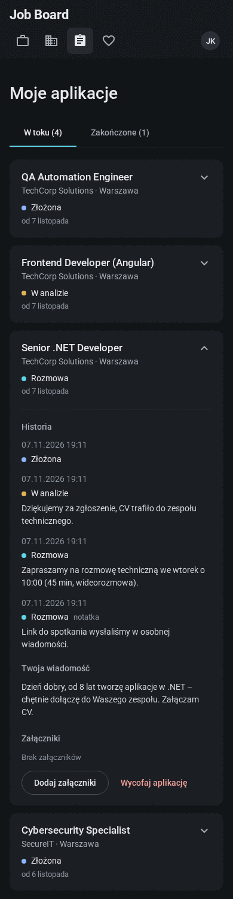 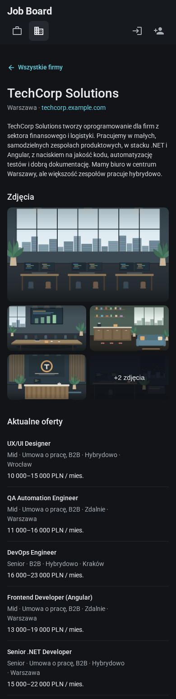 |
